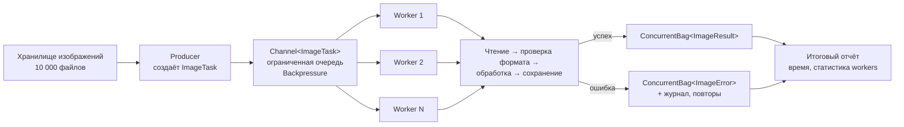

# П2. Анализ поведения параллельной системы и обработка ошибок

## Задание 1. Изменение количества обработчиков

Количество обработчиков выбирается в режиме 2 (одна конфигурация) и режиме 4 (сразу 1, 2, 4 и 8).
Режим 4 повторяет набор файлов из `Data` заданное число раз (по умолчанию 50, то есть 500 заданий), потому что на 10 крошечных файлах время почти равно нулю и сравнивать нечего. Для каждой конфигурации выводятся время, число обработанных файлов, число ошибок и распределение заданий по обработчикам. Таблица сохраняется в `benchmark.md` рядом с исполняемым файлом.

Значения времени зависят от компьютера, поэтому в этом отчёте их нет: я не мог запустить .NET в своей среде и не хочу подставлять выдуманные числа. Заполните таблицу после запуска режима 4.

| Обработчики | Время, мс | Обработано | Ошибок | Распределение |
|---|---|---|---|---|
| 1 | ... | ... | ... | ... |
| 2 | ... | ... | ... | ... |
| 4 | ... | ... | ... | ... |
| 8 | ... | ... | ... | ... |

## Задание 2. Ошибочные задания

Режим 5 обрабатывает пять заданий, третье из которых указывает на несуществующий `missing.txt`.

- Исключение (`FileNotFoundException`) перехватывается в `WorkerAsync` на уровне одного задания через `catch (Exception ex)`. Пустых `catch {}` нет.
- Информация попадает в `Errors` с типом ошибки, именем файла и сообщением.
- Цикл `await foreach` продолжает читать канал, остальные четыре задания обрабатываются.
- Программа не завершается аварийно.
- Ожидаемый отчёт: всего 5, успешно 4, ошибок 1. Режим сам проверяет это условие и выводит `OK` или `НЕ ПРОЙДЕНА`.

## Задание 3. Статистика исполнителей

`ReportService.Create` строит `WorkerStatistics` для всех обработчиков от 1 до `workerCount`, включая тех, кто не получил ни одного задания (с нулём). Блок `СТАТИСТИКА WORKERS` печатается после каждого отчёта, а сами данные попадают в `report.json`.

## Задание 4. Сравнение производительности

| Режим | Обработчики | Время |
|---|---|---|
| Sequential | 1 | ... |
| Parallel | 1 | ... |
| Parallel | 2 | ... |
| Parallel | 4 | ... |
| Parallel | 8 | ... |

Перед выводом таблицы режим 4 проверяет корректность: суммарные строки, слова, символы и число успешных файлов должны совпасть во всех режимах.

**1. Почему параллельная обработка с одним исполнителем может быть медленнее последовательной?**
Появляются накладные расходы, а выигрыша нет: создаются канал, задача производителя и задача обработчика, каждое задание проходит через очередь, а переключения между задачами стоят времени. Один обработчик всё равно выполняет задания по одному, поэтому ускорения не будет.

**2. Почему увеличение количества обработчиков не всегда ускоряет программу?**
Дополнительные исполнители тоже потребляют процессорное время и память. Если узкое место в диске или сети, они лишь ждут одного и того же ресурса. Если файлы крошечные, накладные расходы на планирование сравнимы с самой работой. Число ядер тоже ограничивает полезный параллелизм: сверх него выигрыш обычно исчезает.

**3. Как объём данных влияет на производительность?**
Чем больше данных и чем дороже каждое задание, тем меньше доля накладных расходов и тем заметнее выигрыш от параллелизма. На десяти маленьких файлах последовательный режим может оказаться не хуже, на сотнях и тысячах файлов разница становится видна. Поэтому бенчмарк размножает набор файлов.

**4. Почему важно контролировать количество одновременно выполняемых операций?**
Без ограничения задания накапливаются в памяти, а одновременные операции перегружают процессор, диск или сеть, и всё работает медленнее. Ограниченный канал даёт обратное давление: когда очередь заполнена, производитель ждёт. Фиксированное число обработчиков задаёт предсказуемую нагрузку.

## Задание 5. Анализ архитектуры: обработка 10 000 изображений

**Кто создаёт задания.** Один производитель: сканирует каталог или хранилище (либо читает очередь загрузок) и пишет задания в ограниченный канал. Он не знает, какой обработчик получит задание.

**Что содержит задание.** Только лёгкие данные, а не пиксели: `ImageTask(Id, SourcePath, TargetPath, Operation, Parameters, Attempt)`. Содержимое файла читает обработчик, иначе очередь займёт всю память.

**Что делает обработчик.**
1. Читает файл и проверяет формат.
2. Декодирует изображение.
3. Выполняет операцию (изменение размера, фильтр, сжатие).
4. Сохраняет результат.
5. Освобождает память и берёт следующее задание.

Операция нагружает процессор, поэтому число обработчиков подбирается экспериментально, обычно около `Environment.ProcessorCount`.

**Что сохранять в результатах.** `ImageResult(TaskId, SourcePath, TargetPath, ширина и высота до и после, размер файла до и после, ProcessingTimeMs, WorkerId)`. Результаты собираются в потокобезопасную коллекцию.

**Как регистрировать ошибки.**
- Ошибка перехватывается на уровне одного задания, остальные продолжают работу.
- В `ImageError(TaskId, SourcePath, ErrorType, Message, Attempt)` записывается тип ошибки (повреждённый файл, неподдерживаемый формат, нет доступа, нехватка места).
- Временные сбои повторяются ограниченное число раз, после этого задание уходит в отдельный список проблемных.
- Все ошибки пишутся в журнал и попадают в итоговый отчёт.

**Как контролировать нагрузку.**
- Ограниченный канал с режимом `Wait` даёт обратное давление, задания не теряются.
- Фиксированное число обработчиков.
- Лимит памяти: в очереди только пути, а не изображения.
- `CancellationToken` для корректной остановки.
- Счётчик прогресса и статистика по обработчикам.

**Схема.**

---

# 5. Проверка корректности и типичные ошибки

Как это учтено в проекте:

| Ошибка | Как избегается в проекте |
|---|---|
| Вся логика в одном методе | Анализ файла, распределение заданий и отчёт разнесены по классам |
| Производитель сам выполняет обработку | `ProduceAsync` только пишет в канал |
| Обычный `List<T>` для конкурентной записи | `ConcurrentBag<T>` |
| Не ожидается `Task.WhenAll()` | Ждём и обработчиков, и производителя |
| Ошибка одного задания останавливает систему | `try/catch` внутри цикла обработчика |
| Слишком много исполнителей | Число подбирается экспериментально в режиме 4 |
| Не учитывается длительность заданий | Динамическое распределение через общий канал |
| Сравнение только по времени | Бенчмарк сверяет итоги всех режимов |

# Контрольные вопросы

1. **Что такое Producer–Consumer?** Шаблон, в котором одна часть программы создаёт задания, а другая получает и обрабатывает их, обычно через очередь.
2. **Какие обязанности выполняет производитель?** Получает исходные данные, формирует задания, передаёт их в очередь и сообщает о завершении (`TryComplete`). Обработкой он не занимается.
3. **Для чего нужны потребители?** Они независимо забирают задания из очереди и выполняют их, что позволяет обрабатывать несколько заданий одновременно.
4. **Что такое Worker Pool?** Набор независимых исполнителей, которые выполняют поступающие задания; число исполнителей ограничено.
5. **Почему обработчики должны быть независимыми?** Тогда им не нужно синхронизироваться друг с другом: один может ошибиться или работать медленнее, не мешая остальным, а их число легко менять.
6. **Почему задания могут распределяться неравномерно?** Каждый обработчик берёт следующее задание, когда освободится, а задания имеют разную длительность. Быстрый обработчик выполнит больше заданий.
7. **Почему необходима потокобезопасная коллекция результатов?** Несколько обработчиков записывают одновременно, и обычный `List<T>` при этом может потерять данные или повредиться (гонка данных).
8. **Почему результаты могут поступать не в исходном порядке?** Длительность обработки различается, и быстрее завершившиеся задания записывают результат раньше. Для отчёта результаты сортируют.
9. **Почему увеличение количества обработчиков не всегда ускоряет приложение?** Ограничены ядра, диск и сеть, а каждый обработчик добавляет накладные расходы.
10. **Для чего используется `Task.WhenAll()`?** Чтобы дождаться завершения всех задач; без этого программа может завершиться, не дождавшись обработчиков.
11. **Что произойдёт, если один обработчик завершится с ошибкой?** Если ошибка не перехвачена, `Task.WhenAll` вернёт исключение, и работа этого обработчика прервётся. Поэтому ошибки перехватываются внутри цикла на уровне задания, и обработчик продолжает работать.
12. **Где в реальных приложениях можно использовать такую архитектуру?** Веб-серверы (запросы клиентов), фоновая обработка изображений, рассылка писем через очередь, загрузка и проверка файлов, распределение игровых событий.
